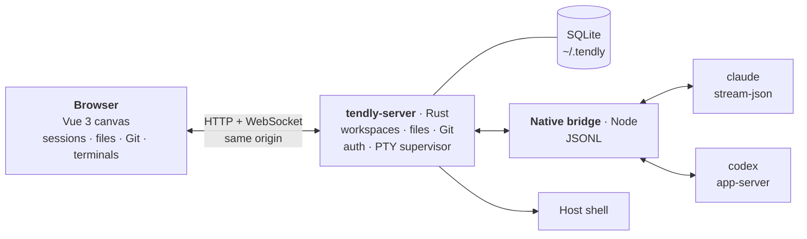

<p align="center">
  <picture>
    <source media="(prefers-color-scheme: dark)" srcset="docs/assets/banner-dark.png">
    
  </picture>
</p>

<p align="center">
  <a href="https://www.rust-lang.org/"></a>
  <a href="https://vuejs.org/"></a>
  <a href="https://nodejs.org/"></a>
  
  <a href="LICENSE"></a>
  <a href="https://linux.do/"></a>
</p>

<p align="center">
  <a href="https://github.com/wnzzer/tendly/actions/workflows/check.yml"></a>
  <a href="https://github.com/wnzzer/tendly/releases"></a>
  <a href="https://www.npmjs.com/package/@wnzzer/tendly"></a>
  <a href="https://www.npmjs.com/package/@wnzzer/tendly"></a>
  <a href="https://github.com/wnzzer/tendly/stargazers"></a>
  <a href="https://gitcode.com/wnzzer/tendly"></a>
</p>

<p align="center">
  <a href="README.zh-CN.md">中文</a> | <strong>English</strong>
</p>

---

> **TL;DR**: `npm i -g @wnzzer/tendly && tendly`, then open `http://127.0.0.1:28789/`. You get the **Claude Code** and **Codex** CLIs you already have installed, inside a browser canvas you can split and dock, next to their files, Git diffs and terminals. It works from a phone too. Tendly has **no agent of its own**: a Rust server and a small Node bridge drive the official clients, so your login, models, hooks, `CLAUDE.md` and permission prompts work the same as in the terminal.

## 📖 Introduction

Claude Code and Codex are at their best in the terminal, and the terminal is also where they get awkward: one agent per window, its diff in another window, its files in a third. When you step away from the desk, you can no longer see what it is doing.

**Tendly** runs on the machine where your code lives (a laptop, a home server or a cloud box) and serves one web page that holds everything:

- **Agent sessions** shown as a structured conversation: tool calls are grouped into cards, and approvals and questions get real buttons.
- **Files, Git and terminals** in panes next to the agent that is changing them.
- **Any number of projects** on the same canvas, each pane bound to its own repository.

It is a workspace, not another agent. Codex runs through its official `app-server` and Claude Code through `stream-json`. When you upgrade a CLI, its new models and features show up in Tendly right away.

<p align="center">
  
</p>
<p align="center"><sub>Two agent sessions side by side, with the Git pane and a diff in the bottom-right corner.</sub></p>

## ✨ Features

### 🤖 The real clients, steered live
- **Native, not re-implemented**: every session is your installed `claude` or `codex`. Sign-in, MCP servers, slash commands and permission prompts behave as in the terminal.
- **Steer without stopping**: <kbd>Enter</kbd> adds to the running turn, <kbd>Alt</kbd>+<kbd>Enter</kbd> queues the next turn, and *Interrupt and send* changes course.
- **Readable output**: grouped tool cards, native approval and question cards, a context-usage ring, rendered tables and code, images in a lightbox. File references such as `src/app.ts:42` open at that line.
- **Pick up old work**: resume native Claude Code and Codex history for each workspace. You can archive, select several and delete sessions, or use a temporary session for a throwaway question.

### 🧩 One canvas for every project
- **Split, tab and dock** with recursive splits, drag-to-edge docking and `1:1` / `2×2` / `1:2:1` presets.
- **Panes don't own processes**: closing a pane never ends its session, and the layout is saved on the server so any browser sees the same canvas.
- **One branch per session**: give a session its own branch and it works in a Git worktree, so two agents can build two features at once.

### 🔑 Accounts, endpoints and models
- **Official accounts** with the remaining 5-hour and weekly quota at a glance.
- **Endpoint per session**: the host's sign-in, a custom gateway, or an isolated client home. Environment variables can be set per session and can reference secrets.
- **Model and thinking depth** switch from the message box, or type any model ID. You can hand a conversation from Claude Code to Codex, and back.

### 📁 Files, Git and terminals
- A file tree and editor that follow changes on disk live, `.gitignore`-aware search, `@path` completion and conflict-checked saves.
- Previews for Markdown, images, video, audio and PDF.
- A Git pane for status, diff, stage, discard and commit, plus branches and worktrees.
- Real host terminals. On Windows they open PowerShell, and `TENDLY_SHELL` picks another shell.

### 📱 Any screen
- When space runs out, splits fold into tabs. On a phone you get a drawer sidebar, bottom-sheet menus, and long-press for right-click.
- English and Chinese UI, light and dark themes with three palettes, separate interface and conversation fonts, and CPU and memory in the status bar.

## 📸 Screenshots

**Steer a running turn**: the message joins the turn that is already running. The send menu offers queue or interrupt.

<p align="center">
  
</p>

**On a phone**: the same canvas, with the split folded into tabs.

<p align="center">
  
</p>

**Accounts, endpoints and models**

<table>
  <tr>
    <td width="33%"></td>
    <td width="33%"></td>
    <td width="33%"></td>
  </tr>
  <tr>
    <td align="center"><sub>Official accounts with 5-hour and weekly quota</sub></td>
    <td align="center"><sub>Endpoints: host sign-in, gateway or isolated home</sub></td>
    <td align="center"><sub>Model and thinking depth from the message box</sub></td>
  </tr>
</table>

## 🚀 Quick start

1. **Install.** You need Node.js 24+ and [Claude Code](https://www.npmjs.com/package/@anthropic-ai/claude-code) and/or [Codex](https://www.npmjs.com/package/@openai/codex) on the same machine.

   ```bash
   npm install -g @wnzzer/tendly
   tendly             # starts in the background → http://127.0.0.1:28789/
   ```

   > Prebuilt for macOS (arm64, x64), Linux (x64, arm64, static musl) and Windows (x64), with no postinstall step. Other platforms can [build from source](docs/development.md).

2. **Pick a workspace**: any directory on the host.

3. **Reuse your sign-in** from *Settings → Official accounts → Import existing configuration*, or add an account or a gateway.

4. **Create a session** or **load an existing one**, and start typing.

| Command | What it does |
| --- | --- |
| `tendly` / `tendly --lan` | Start in the background, on loopback or on every interface |
| `tendly status` · `logs` | Show the URL, access token and server log |
| `tendly restart` · `stop` | Restart or stop the background server |
| `tendly update` · `--check` | Install the latest npm release (or only check). *Settings → Updates* does the same |
| `tendly serve` | Run in the foreground, for systemd or another supervisor |

## 🌐 Using it from another device

State lives in `~/.tendly/` (SQLite, settings, logs), and Tendly sends **no telemetry**. Settings are read from `~/.tendly/config.toml`, and matching `TENDLY_*` environment variables override them:

```toml
lan = true                  # same as --lan
port = 28789                # or addr = "192.168.0.9:28789"
token = "..."               # TENDLY_TOKEN
allowed-origins = ["https://dock.example.com"]
```

- **SSH forwarding** is the simplest safe option: `ssh -L 28789:127.0.0.1:28789 user@server`.
- **`--lan`** serves plain HTTP. Use it only on networks you trust.
- **An HTTPS reverse proxy** works too, as long as it keeps the `Host` header and WebSocket upgrades.

All options are in [Configuration](docs/configuration.md).

> [!WARNING]
> Tendly is for **a single trusted user**. Anyone who can reach it has your user's permissions, and `claude` / `codex` run **unsandboxed**. Read [Security and boundaries](docs/security.md) before you expose it beyond localhost.

## ❓ FAQ

<details>
<summary><b>Is this a Claude Code / Codex replacement or a wrapper around the API?</b></summary>
<br>
Neither. Tendly starts the official CLIs you have installed and talks to them through their own machine interfaces: Codex's <code>app-server</code> and Claude Code's <code>stream-json</code>. It does not run an agent loop itself.
</details>

<details>
<summary><b>Do I need an API key?</b></summary>
<br>
No. Each session uses whatever the CLI would use: the host's existing sign-in, an official account added in Settings, or a custom gateway endpoint. See <a href="docs/official-accounts.md">Official accounts</a> and <a href="docs/endpoint-profiles.md">Endpoint profiles</a>.
</details>

<details>
<summary><b>What happens when I close the browser tab?</b></summary>
<br>
Sessions run on the server, so the agent keeps working. Open Tendly again from any browser, including a phone, and the canvas and sessions are where you left them.
</details>

<details>
<summary><b>Can two agents work on the same repository at once?</b></summary>
<br>
Yes. Give each session its own branch and Tendly creates a Git worktree for it, so the two agents don't change the same files.
</details>

## 🧱 How it works



The Rust server handles the protocol, auth, persistence and process supervision. The Node bridge maps each client's official interface to session events. More detail is in [Architecture](docs/architecture.md), and the remaining guides are in [`docs/`](docs).

## 🛠️ Development

Requires Rust 1.89+, Node.js 24+ and pnpm 10.30.3.

```bash
pnpm install --frozen-lockfile
pnpm run dev       # → http://127.0.0.1:5173/
pnpm run check && cargo test --workspace
```

[Development](docs/development.md) has the full check list and the repository layout.

## 🤝 Contributing

Issues and pull requests are welcome. Report bugs and request features on [GitHub Issues](https://github.com/wnzzer/tendly/issues).

## 📄 License

[MIT](LICENSE). Third-party material is listed in [third-party notices](docs/third-party-notices.md). Claude Code and Codex are products of Anthropic and OpenAI respectively. Tendly is an independent project and is not affiliated with or endorsed by either company.

Thanks to the [LINUX DO](https://linux.do/) community.

## ⭐ Star History

[](https://star-history.dera.page/#wnzzer/tendly&Date)
