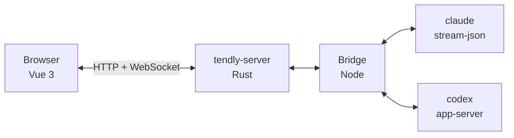

<h3 align="center">
  <picture>     <source media="(prefers-color-scheme: dark)" srcset="docs/assets/wordmark-dark.png">        </picture><br>   One canvas for the official Claude Code and Codex CLIs, on your own machine
</h3>

<p align="center">
  <a href="https://www.npmjs.com/package/@wnzzer/tendly"></a>   <a href="docs/"></a>   <a href="README.zh-CN.md"></a>   <a href="LICENSE"></a>   <a href="https://github.com/wnzzer/tendly/stargazers"></a>   <a href="https://gitcode.com/wnzzer/tendly"></a>
</p>

<p align="center">
  <a href="docs/assets/screenshot-canvas.png">        </a>
</p>

Claude Code and Codex are at their best in a terminal, which also holds them to one agent per window, with the diff in a second window and the files in a third.

**Tendly** puts them on one web canvas, next to the files, Git and terminals they work on. It runs on the machine where your code lives and drives the CLIs you have already installed and signed in to, so your models, hooks, MCP, `CLAUDE.md` and permission prompts behave exactly as in the terminal. It has no agent of its own.

It supports **Claude Code and Codex**, runs on **macOS, Linux and Windows**, and works in **desktop and phone browsers**.

## Contents

- [Install](#install)
- [The canvas](#the-canvas)
- [Accounts and endpoints](#accounts-and-endpoints)
- [From a phone or another computer](#from-a-phone-or-another-computer)
- [How it works](#how-it-works)
- [Development](#development)
- [License](#license)

## Install

Use **Node.js 24+**, with [Claude Code](https://www.npmjs.com/package/@anthropic-ai/claude-code) and/or [Codex](https://www.npmjs.com/package/@openai/codex) on the same machine:

```bash
npm install -g @wnzzer/tendly
tendly
```

Open <http://127.0.0.1:28789/>, pick a directory as the workspace, import your existing sign-in from *Settings → Official accounts*, and create a session.

| Command | Behavior |
|---|---|
| `tendly` | Start in the background, on loopback |
| `tendly status` | Show the URL and access token |
| `tendly logs` | Show the server log |
| `tendly update` | Install the latest release |
| `tendly stop` / `restart` | Stop or restart the server |
| `tendly serve` | Run in the foreground, for systemd |

Prebuilt for macOS (arm64, x64), Linux (x64, arm64) and Windows (x64). State lives in `~/.tendly/` and Tendly sends no telemetry. See [Configuration](docs/configuration.md) for every option.

## The canvas

A canvas holds **agent sessions, a file tree and editor, a Git pane and terminals**, from any number of projects, in recursive splits and tabs. Panes don't own processes: close a pane or the browser and the session keeps running.

<p align="center">
  <a href="docs/assets/screenshot-steer.png">        </a>
</p>
<p align="center"><em>Tool calls fold into cards, and you can add to a turn while it runs.</em></p>

| Action | How |
|---|---|
| Add to the running turn | <kbd>Enter</kbd> |
| Queue the next turn | <kbd>Alt</kbd>+<kbd>Enter</kbd> |
| Run two agents on one repository | Start each as an isolated task: its own worktree and branch, with dependencies and `.env` ready, merged back after review |
| Resume old work | Open native Claude Code or Codex history from the workspace |
| Switch clients mid-task | Hand the conversation from Claude Code to Codex, or back |

See [Sessions and canvas](docs/sessions-and-canvas.md) for layouts, docking and the Git pane.

## Accounts and endpoints

Each session picks where its CLI signs in. Official accounts show the 5-hour and weekly quota they have left.

<p align="center">
  <a href="docs/assets/screenshot-accounts.png">        </a>
</p>

| Source | Use it for |
|---|---|
| Host sign-in | Whatever `claude` or `codex` already uses on this machine |
| Official account | More Claude Code or Codex sign-ins, each in its own client home |
| Endpoint profile | A custom gateway or API provider, with its own models |

See [Official accounts](docs/official-accounts.md) and [Endpoint profiles](docs/endpoint-profiles.md).

## From a phone or another computer

On a narrow screen, splits fold into tabs, menus become bottom sheets and a long press stands in for right-click.

<p align="center">
  <a href="docs/assets/screenshot-mobile.png">        </a>
</p>

| Method | Reach |
|---|---|
| Tailscale (*Settings → Remote access*) | Your tailnet only, over HTTPS |
| `ssh -L 28789:127.0.0.1:28789 user@server` | Anyone with SSH access |
| `tendly --lan` | Your whole network, plain HTTP |

> [!WARNING]
> Tendly is for **a single trusted user**: anyone who can reach it has your user's permissions, and `claude` / `codex` run **unsandboxed**. Read [Security](docs/security.md) before exposing it beyond localhost.

## How it works



The Rust server handles the protocol, auth, SQLite and process supervision; the Node bridge maps each client's official interface to session events. See [Architecture](docs/architecture.md).

## Development

Use **Rust 1.89+, Node.js 24+ and pnpm 10.30.3**:

```bash
pnpm install --frozen-lockfile
pnpm run dev       # → http://127.0.0.1:5173/
pnpm run check && cargo test --workspace
```

See [Development](docs/development.md) for the full check list. [Issues](https://github.com/wnzzer/tendly/issues) and pull requests are welcome.

## License

Tendly is licensed under [MIT](LICENSE); see [third-party notices](docs/third-party-notices.md). Claude Code and Codex are products of Anthropic and OpenAI; Tendly is an independent project, not affiliated with or endorsed by either. Thanks to the [LINUX DO](https://linux.do/) community.

[](https://star-history.dera.page/#wnzzer/tendly&Date)
