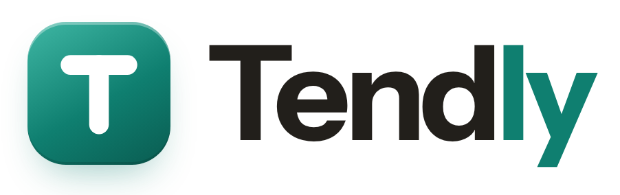
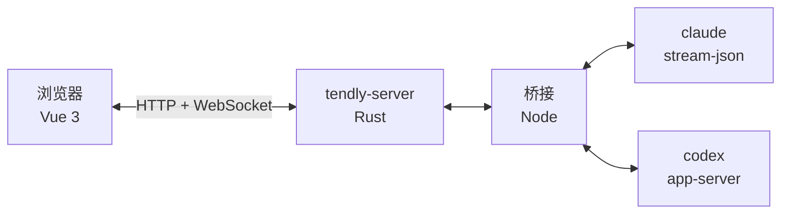

<h3 align="center">
  <picture>    <source media="(prefers-color-scheme: dark)" srcset="docs/assets/wordmark-dark.png">      </picture><br>  在你自己的机器上，用一张画布驾驭官方 Claude Code 与 Codex CLI
</h3>

<p align="center">
  <a href="https://www.npmjs.com/package/@wnzzer/tendly"></a>  <a href="docs/"></a>  <a href="README.md"></a>  <a href="LICENSE"></a>  <a href="https://github.com/wnzzer/tendly/stargazers"></a>  <a href="https://gitcode.com/wnzzer/tendly"></a>
</p>

<p align="center">
  <a href="docs/assets/screenshot-canvas.zh-CN.png">      </a>
</p>

Claude Code 和 Codex 在终端里最好用，也被终端限制住：一个窗口只能盯一个 Agent，diff 在第二个窗口，文件在第三个。

**Tendly** 把它们放到一张网页画布上，旁边就是它们在改的文件、Git 和终端。它运行在代码所在的机器上，直接驱动你已经装好、登录好的 CLI，所以模型、hooks、MCP、`CLAUDE.md` 和权限确认都和终端里一模一样。它自己不带 Agent。

支持 **Claude Code 和 Codex**，运行在 **macOS、Linux 和 Windows** 上，**电脑和手机浏览器**都能用。

## 目录

- [安装](#安装)
- [画布](#画布)
- [账号与端点](#账号与端点)
- [从手机或其他电脑访问](#从手机或其他电脑访问)
- [工作原理](#工作原理)
- [开发](#开发)
- [许可证](#许可证)

## 安装

需要 **Node.js 24+**，以及同一台机器上的 [Claude Code](https://www.npmjs.com/package/@anthropic-ai/claude-code)和/或 [Codex](https://www.npmjs.com/package/@openai/codex)：

```bash
npm install -g @wnzzer/tendly
tendly
```

打开 <http://127.0.0.1:28789/>，选一个目录当工作区，在 *设置 → 官方账号* 引入已有登录，然后新建会话。

| 命令 | 作用 |
|---|---|
| `tendly` | 后台启动，只监听本机 |
| `tendly status` | 查看访问地址和令牌 |
| `tendly logs` | 查看服务日志 |
| `tendly update` | 升级到最新版 |
| `tendly stop` / `restart` | 停止或重启服务 |
| `tendly serve` | 前台运行，给 systemd 用 |

提供 macOS（arm64、x64）、Linux（x64、arm64）和 Windows（x64）预编译包。状态都在`~/.tendly/`，没有任何遥测。全部选项见[配置](docs/configuration.md)。

## 画布

一张画布可以放 **Agent 会话、文件树与编辑器、Git 窗格和终端**，来自任意多个项目，递归分屏、标签页随意排。窗格不绑进程：关掉窗格或浏览器，会话照跑。

<p align="center">
  <a href="docs/assets/screenshot-steer.zh-CN.png">      </a>
</p>
<p align="center"><em>工具调用折叠成卡片，一轮还在跑也能补一句。</em></p>

| 操作 | 方法 |
|---|---|
| 插进正在跑的这一轮 | <kbd>Enter</kbd> |
| 排到下一轮 | <kbd>Alt</kbd>+<kbd>Enter</kbd> |
| 两个 Agent 改同一个仓库 | 各自作为隔离任务启动：独占的 worktree 和分支，依赖和 `.env` 已备好，审阅后合并回去 |
| 接着之前的活干 | 在工作区里打开原生 Claude Code 或 Codex 历史 |
| 中途换客户端 | 把对话从 Claude Code 交给 Codex，或反过来 |

布局、停靠和 Git 窗格见[会话与画布](docs/sessions-and-canvas.md)。

## 账号与端点

每个会话自己选 CLI 用哪份登录。官方账号会显示 5 小时和本周剩余额度。

<p align="center">
  <a href="docs/assets/screenshot-accounts.zh-CN.png">      </a>
</p>

| 来源 | 适合 |
|---|---|
| 本机登录 | `claude` 或 `codex` 在这台机器上本来就用的登录 |
| 官方账号 | 更多 Claude Code 或 Codex 登录，各自独立的客户端目录 |
| 端点配置 | 自定义网关或 API 服务商，带自己的模型 |

见[官方账号](docs/official-accounts.md)和[端点配置](docs/endpoint-profiles.md)。

## 从手机或其他电脑访问

屏幕窄时，分屏折叠成标签页，菜单变成底部弹层，长按代替右键。

<p align="center">
  <a href="docs/assets/screenshot-mobile.zh-CN.png">      </a>
</p>

| 方式 | 谁能连 |
|---|---|
| Tailscale（*设置 → 远程访问*） | 只有你的 tailnet，全程 HTTPS |
| `ssh -L 28789:127.0.0.1:28789 user@server` | 有 SSH 权限的人 |
| `tendly --lan` | 整个局域网，明文 HTTP |

> [!WARNING]
> Tendly 只面向**单个受信任用户**：能访问它的人拥有你这个系统用户的全部权限，`claude` / `codex` 也**不在沙箱中运行**。开放到本机以外之前，请先读[安全与边界](docs/security.md)。

## 工作原理



Rust 服务端负责协议、鉴权、SQLite 和进程监管；Node 桥接把各客户端的官方接口映射成会话事件。见[架构](docs/architecture.md)。

## 开发

需要 **Rust 1.89+、Node.js 24+ 和 pnpm 10.30.3**：

```bash
pnpm install --frozen-lockfile
pnpm run dev       # → http://127.0.0.1:5173/
pnpm run check && cargo test --workspace
```

完整检查清单见[开发文档](docs/development.md)。欢迎提 [Issue](https://github.com/wnzzer/tendly/issues) 和 PR。

## 许可证

Tendly 以 [MIT](LICENSE) 许可发布，第三方内容见[第三方声明](docs/third-party-notices.md)。Claude Code 和 Codex 分别是 Anthropic 和 OpenAI 的产品；Tendly 是独立项目，与两家公司没有隶属或背书关系。感谢 [LINUX DO](https://linux.do/) 社区。

[](https://star-history.dera.page/#wnzzer/tendly&Date)
