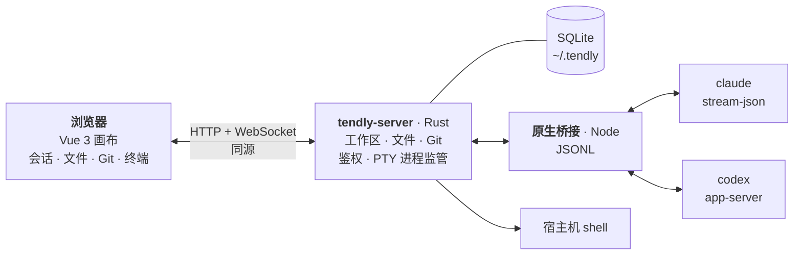

<p align="center">
  <picture>
    <source media="(prefers-color-scheme: dark)" srcset="docs/assets/banner-dark.png">
    
  </picture>
</p>

<p align="center">
  <a href="https://www.rust-lang.org/"></a>
  <a href="https://vuejs.org/"></a>
  <a href="https://nodejs.org/"></a>
  
  <a href="LICENSE"></a>
  <a href="https://linux.do/"></a>
</p>

<p align="center">
  <a href="https://github.com/wnzzer/tendly/actions/workflows/check.yml"></a>
  <a href="https://github.com/wnzzer/tendly/releases"></a>
  <a href="https://www.npmjs.com/package/@wnzzer/tendly"></a>
  <a href="https://www.npmjs.com/package/@wnzzer/tendly"></a>
  <a href="https://github.com/wnzzer/tendly/stargazers"></a>
  <a href="https://gitcode.com/wnzzer/tendly"></a>
</p>

<p align="center">
  <strong>中文</strong> | <a href="README.md">English</a>
</p>

---

> **一句话版**：`npm i -g @wnzzer/tendly && tendly`，打开 `http://127.0.0.1:28789/`，你本机已装的 **Claude Code** 和 **Codex** 就出现在一张可分屏、可停靠的浏览器画布里，旁边是它们正在改的文件、Git diff 和终端，手机也能用。Tendly **自己不带 Agent**：Rust 服务端加一个很薄的 Node 桥接，直接驱动官方客户端，所以登录、模型、hooks、`CLAUDE.md` 和权限确认都和终端里一模一样。

## 📖 简介

Claude Code 和 Codex 在终端里最好用，也正是在终端里最别扭：一个窗口只能盯一个 Agent，看它的 diff 要切到另一个窗口，看文件又是第三个；人一离开电脑，就不知道它跑到哪一步了。

**Tendly** 运行在代码所在的机器上（笔记本、家里的服务器或云主机都行），只提供一个网页，所有东西都在里面：

- **Agent 会话**以结构化对话呈现：工具调用折叠成卡片，权限确认和提问都有真正的按钮。
- **文件、Git 和终端**作为窗格，放在正在改动它们的 Agent 旁边。
- **任意多个项目**共用一张画布，每个窗格绑定各自的仓库。

它是工作台，不是又一个 Agent。Codex 走官方 `app-server`，Claude Code 走 `stream-json`。CLI 一升级，新模型和新功能马上就能在 Tendly 里用。

<p align="center">
  
</p>
<p align="center"><sub>两个 Agent 会话并排，右下角是 Git 窗格和 diff。</sub></p>

## ✨ 功能

### 🤖 官方客户端，边跑边纠正
- **原生而非重写**：每个会话都是你本机安装的 `claude` 或 `codex`，登录、MCP 服务、斜杠命令和权限确认都与终端一致。
- **不打断地引导**：<kbd>Enter</kbd> 把消息加入正在进行的这一轮，<kbd>Alt</kbd>+<kbd>Enter</kbd> 排到下一轮，**中断并发送**直接改方向。
- **输出好读**：工具卡片折叠，原生权限与提问卡片，上下文用量环，表格和代码正常渲染，图片可放大。`src/app.ts:42` 这类文件引用点开即跳到对应行。
- **接着之前的活干**：按工作区恢复原生 Claude Code 与 Codex 历史；会话可以归档、多选、删除，一次性的问题用临时会话。

### 🧩 所有项目一张画布
- **分屏、标签、停靠**：递归分屏、拖到边缘停靠，以及 `1:1` / `2×2` / `1:2:1` 预设。
- **窗格不绑进程**：关掉窗格不会结束会话；布局保存在服务端，换个浏览器打开还是同一张画布。
- **每个会话一个分支**：给会话指定分支，它就在独立的 Git worktree 里工作，两个 Agent 可以同时开发两个功能。

### 🔑 账号、端点与模型
- **官方账号**：5 小时与本周剩余额度一目了然。
- **每个会话自选端点**：本机登录、自定义网关或独立客户端环境；会话级环境变量，支持引用密钥。
- **模型与思考深度**在输入框里切换，也可以手动输入任意模型 ID；还能把对话从 Claude Code 交给 Codex，或反过来。

### 📁 文件、Git 与终端
- 文件树和编辑器实时跟随磁盘变化，遵守 `.gitignore` 的搜索，`@路径` 补全，带冲突检测的保存。
- Markdown、图片、视频、音频和 PDF 预览。
- Git 窗格支持状态、diff、暂存、丢弃和提交，以及分支与 worktree。
- 真正的宿主机终端。Windows 上默认打开 PowerShell，可用 `TENDLY_SHELL` 换成其他 shell。

### 📱 任何屏幕
- 空间不够时分屏自动折叠成标签页；手机上有抽屉侧边栏、底部弹出菜单，长按代替右键。
- 中英文界面，明暗模式与三套配色，界面字体和对话字体可分开选，状态栏显示 CPU 与内存。

## 📸 截图

**引导进行中的一轮**：消息直接加入正在跑的这一轮，发送菜单里还有排队和中断。

<p align="center">
  
</p>

**手机上**：同一张画布，分屏折叠成了标签页。

<p align="center">
  
</p>

**账号、端点与模型**

<table>
  <tr>
    <td width="33%"></td>
    <td width="33%"></td>
    <td width="33%"></td>
  </tr>
  <tr>
    <td align="center"><sub>官方账号，5 小时与本周额度一目了然</sub></td>
    <td align="center"><sub>端点：本机登录、网关或隔离环境</sub></td>
    <td align="center"><sub>模型与思考深度在输入框里切换</sub></td>
  </tr>
</table>

## 🚀 快速开始

1. **安装**：需要 Node.js 24+，并在同一台机器上装好 [Claude Code](https://www.npmjs.com/package/@anthropic-ai/claude-code) 和/或 [Codex](https://www.npmjs.com/package/@openai/codex)。

   ```bash
   npm install -g @wnzzer/tendly
   tendly             # 后台启动 → http://127.0.0.1:28789/
   ```

   > 提供 macOS（arm64、x64）、Linux（x64、arm64，静态 musl）和 Windows（x64）预编译包，没有 postinstall 步骤。其他平台可[从源码构建](docs/development.md)。

2. **选择工作区**：宿主机上任意目录。

3. **复用已有登录**：*设置 → 官方账号 → 引入现有配置*，或者添加账号、网关。

4. **新建会话**或**加载已有会话**，开始对话。

| 命令 | 作用 |
| --- | --- |
| `tendly` / `tendly --lan` | 后台启动，仅本机或所有网卡 |
| `tendly status` · `logs` | 查看访问地址、访问 token 与服务日志 |
| `tendly restart` · `stop` | 重启或停止后台服务 |
| `tendly update` · `--check` | 安装 npm 上的最新版（或只检查）；*设置 → 更新* 效果相同 |
| `tendly serve` | 前台运行，用于 systemd 等进程管理器 |

## 🌐 从其他设备访问

状态保存在 `~/.tendly/`（SQLite、设置、日志），**没有任何遥测**。设置读取自 `~/.tendly/config.toml`，同名 `TENDLY_*` 环境变量优先：

```toml
lan = true                  # 等同于 --lan
port = 28789                # 或 addr = "192.168.0.9:28789"
token = "..."               # TENDLY_TOKEN
allowed-origins = ["https://dock.example.com"]
```

- **SSH 端口转发**最简单也最安全：`ssh -L 28789:127.0.0.1:28789 user@server`。
- **`--lan`** 是明文 HTTP，只适合可信网络。
- **HTTPS 反向代理**也可以，但要保留 `Host` 头和 WebSocket 升级。

全部选项见[配置](docs/configuration.md)。

> [!WARNING]
> Tendly 只面向**单个受信任用户**。能访问它的人就拥有你这个用户的全部权限，且 `claude` / `codex` **不在沙箱中运行**。在 localhost 之外开放前，请先阅读[安全与边界](docs/security.md)。

## ❓ 常见问题

<details>
<summary><b>它是 Claude Code / Codex 的替代品，还是 API 套壳？</b></summary>
<br>
都不是。Tendly 启动的是你本机安装的官方 CLI，通过它们自己的机器接口通信：Codex 的 <code>app-server</code> 和 Claude Code 的 <code>stream-json</code>。它自身不运行 Agent 循环。
</details>

<details>
<summary><b>需要 API Key 吗？</b></summary>
<br>
不需要。每个会话用的就是 CLI 本来会用的凭据：本机已有登录、在设置里添加的官方账号，或自定义网关端点。详见<a href="docs/official-accounts.md">官方账号</a>与<a href="docs/endpoint-profiles.md">端点配置</a>。
</details>

<details>
<summary><b>关掉浏览器标签页会怎样？</b></summary>
<br>
会话运行在服务端，Agent 会继续工作。之后从任何浏览器（包括手机）重新打开 Tendly，画布和会话都还在原处。
</details>

<details>
<summary><b>两个 Agent 能同时改同一个仓库吗？</b></summary>
<br>
可以。给每个会话指定各自的分支，Tendly 会为它创建 Git worktree，两个 Agent 不会改到同一份文件。
</details>

## 🧱 工作原理



Rust 服务端负责协议、鉴权、持久化和进程监管；Node 桥接把各客户端的官方接口映射为会话事件。更多细节见[架构](docs/architecture.md)，其余文档都在 [`docs/`](docs) 目录。

## 🛠️ 开发

需要 Rust 1.89+、Node.js 24+ 和 pnpm 10.30.3。

```bash
pnpm install --frozen-lockfile
pnpm run dev       # → http://127.0.0.1:5173/
pnpm run check && cargo test --workspace
```

完整检查清单与目录结构见[开发文档](docs/development.md)。

## 🤝 参与贡献

欢迎提 Issue 和 PR。Bug 和功能建议请提到 [GitHub Issues](https://github.com/wnzzer/tendly/issues)。

## 📄 许可证

[MIT](LICENSE)。第三方内容见[第三方声明](docs/third-party-notices.md)。Claude Code 和 Codex 分别是 Anthropic 和 OpenAI 的产品。Tendly 是独立项目，与这两家公司没有隶属或背书关系。

感谢 [LINUX DO](https://linux.do/) 社区。

## ⭐ Star History

[](https://star-history.dera.page/#wnzzer/tendly&Date)
